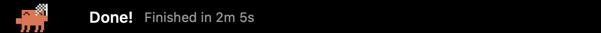
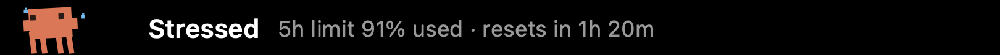
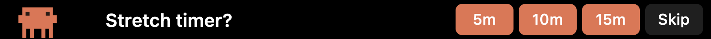

# Touchbar Claude

A little Claude guy on your MacBook Touch Bar that shows what Claude Code is doing!

## What it shows

#### Ready


#### Building


#### Needs you


#### Done


#### Little moments
- **Stretch timer:** after an hour of Claude working, once it's idle the bar asks **Stretch timer?**
  - Tap **5m**, **10m** or **15m** to start a countdown. It shows on the bar, even while Claude works.
  - While the timer runs, the mascot stays put and stretches every 30 seconds.
  - When the timer ends, the mascot does a full stretch and the bar pops up.
  - Tap **Skip**, or ignore the prompt for 20 seconds, and it asks again after another hour of work.
  - To cancel a running timer, use the menu bar icon → **Cancel stretch timer**.
- **Morning yawn:** the first time the bar is idle each morning (6 to 11), it yawns.

#### Napping
After 2 minutes with nothing happening, the mascot dozes off where it stands. It wakes when Claude gets busy, a session starts or ends, or you tap, hold or pet it.

#### Tired and stressed
- **Tired** (dozing, with z's): the session's context window is at least 80% full. Try `/compact`.
- **Stressed** (trembling and sweating): your 5-hour or weekly usage limit is at least 80% used.

## Tap and hold

- **Tap** the bar to jump back to your Claude session.
- **No session running?** The mascot wanders along the bar on its own. Tap once to see **Tap to start Claude**, then tap again to open Terminal and start `claude` in your home folder.
- **Pet** the mascot by dragging a finger back and forth over it while it isn't busy: it smiles, puts on a bow and jumps for joy.
- **Hold** the mascot to see more: the model, how much context is used, and your usage limits.
- **Change model or effort:** in that view, tap **MODEL**, choose **Model** or **Effort**, then tap an option. The app types `/model` or `/effort` into the session's Terminal tab (Terminal only, and only while Claude is idle). macOS asks for permission the first time. Claude Code also saves the choice as your default. With no session running, the choice applies to sessions you start from the bar.


## Menu bar icon

Click the Touchbar Claude icon in the menu bar for:

- **Status:** what Claude is doing right now.
- **Show on Touch Bar** / **Hide from Touch Bar**
- **Keep on Touch Bar:** brings the bar back on every status change.
- **Pop up when status changes:** brings the bar back when Claude needs you or finishes.
- **Cancel stretch timer:** shown only while a timer runs.
- **Preview animation:** plays any state without a session, for example Building, Needs you, Done + flag, Tired, Stressed, Napping, Stretch break, Morning yawn and the Stretch timer prompt.
- **Quit Touchbar Claude**

## Features on the touchbar

These are renders of each state from the app's drawing code, not photos of a Touch Bar. The files are in [`screenshots/`](screenshots).

| Feature | Screenshot |
|---|---|
| Ready (session open) |  |
| Tap to start Claude (no session) |  |
| Building |  |
| Needs you |  |
| Done + flag |  |
| Tired (context full) |  |
| Stressed (usage limit) |  |
| Napping |  |
| Petting |  |
| Stretch break |  |
| Morning yawn |  |
| Stretch timer prompt |  |
| Stretch timer countdown |  |
| Hold: model, context, usage |  |
| Change model |  |
| Change effort |  |
| Next session (no session open) |  |

## Install

Open Terminal and go to the project folder:
```bash
cd path/to/touchbar-claude
```

Run the installer. It builds the app, sets up the Claude Code hooks and starts it:
```bash
./install.sh
```

To have it start on its own every time you log in, run this once instead:
```bash
./install.sh --login
```

## Everyday use

You only need to install once. After that:

- **Start it** (for example after restarting your Mac): `open "build/Touchbar Claude.app"`
- **After changing the code:** `./build.sh`, then quit Touchbar Claude from its menu bar icon and open it again
- **Preview an animation:** menu bar icon → Preview animation
- **Stop it:** menu bar icon → Quit Touchbar Claude

The first time you change the model or effort from the bar, macOS asks whether Touchbar Claude may control Terminal. Click **Allow**. You can change this later in System Settings → Privacy & Security → Automation.


## Credits

Touchbar Claude started as [nokzon/touchbar-claude](https://github.com/nokzon/touchbar-claude). This version adds a clickable start for Claude sessions, model and effort choices from the bar, napping, a stretch timer, a morning yawn, and more.

## Uninstall
```bash
./install.sh --uninstall
```
